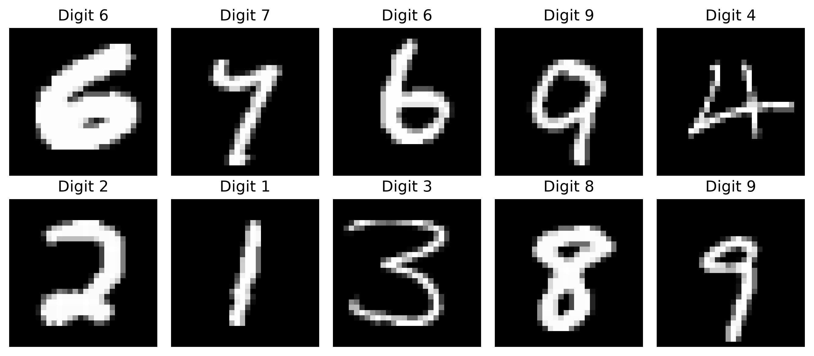
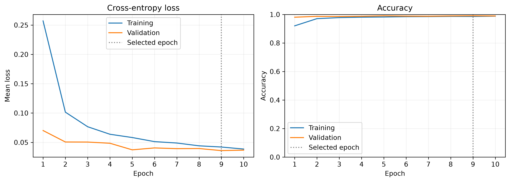
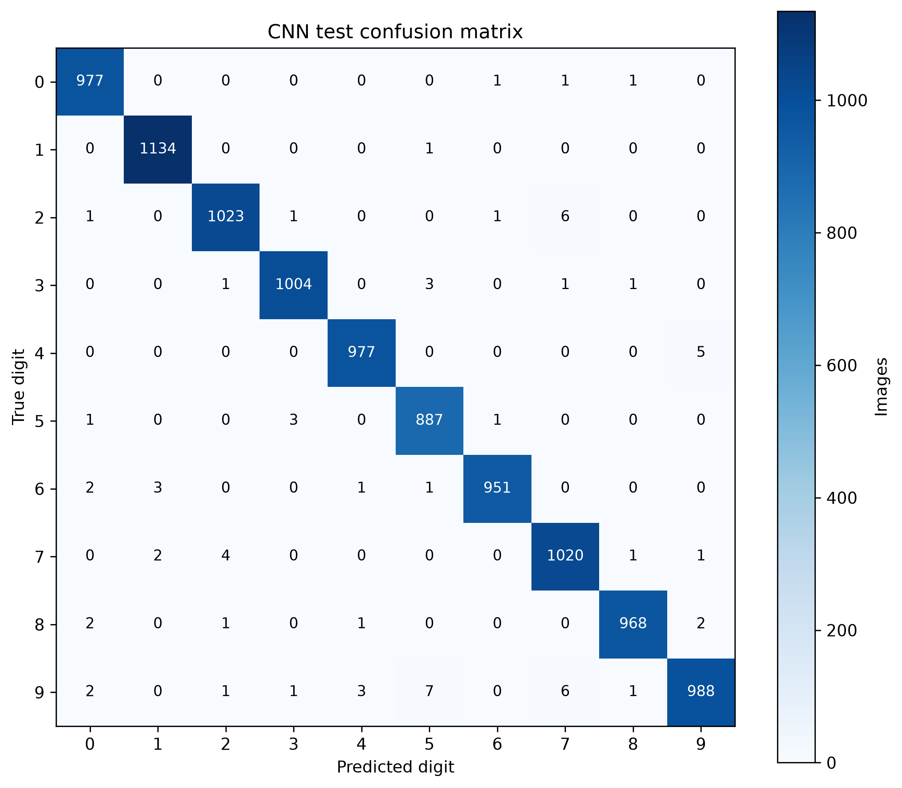
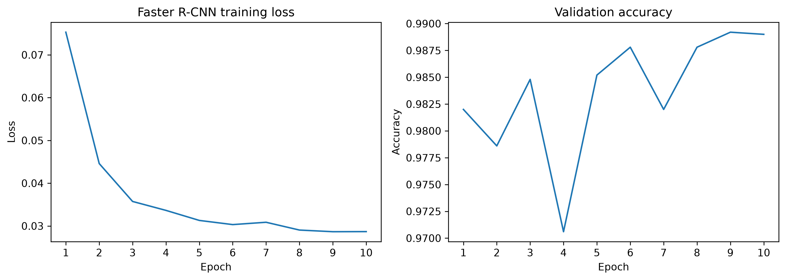
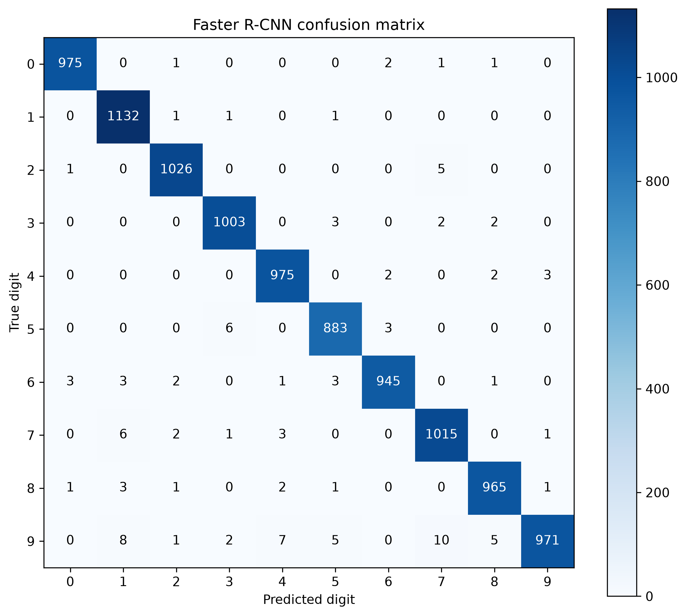
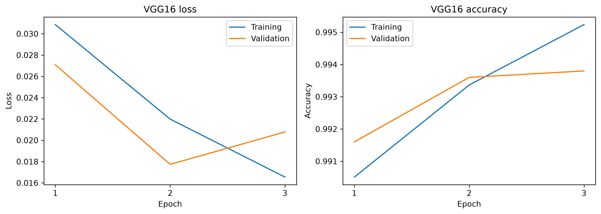
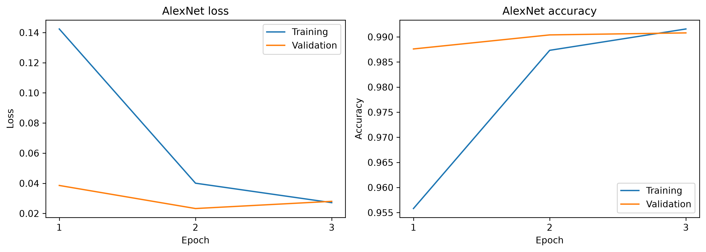
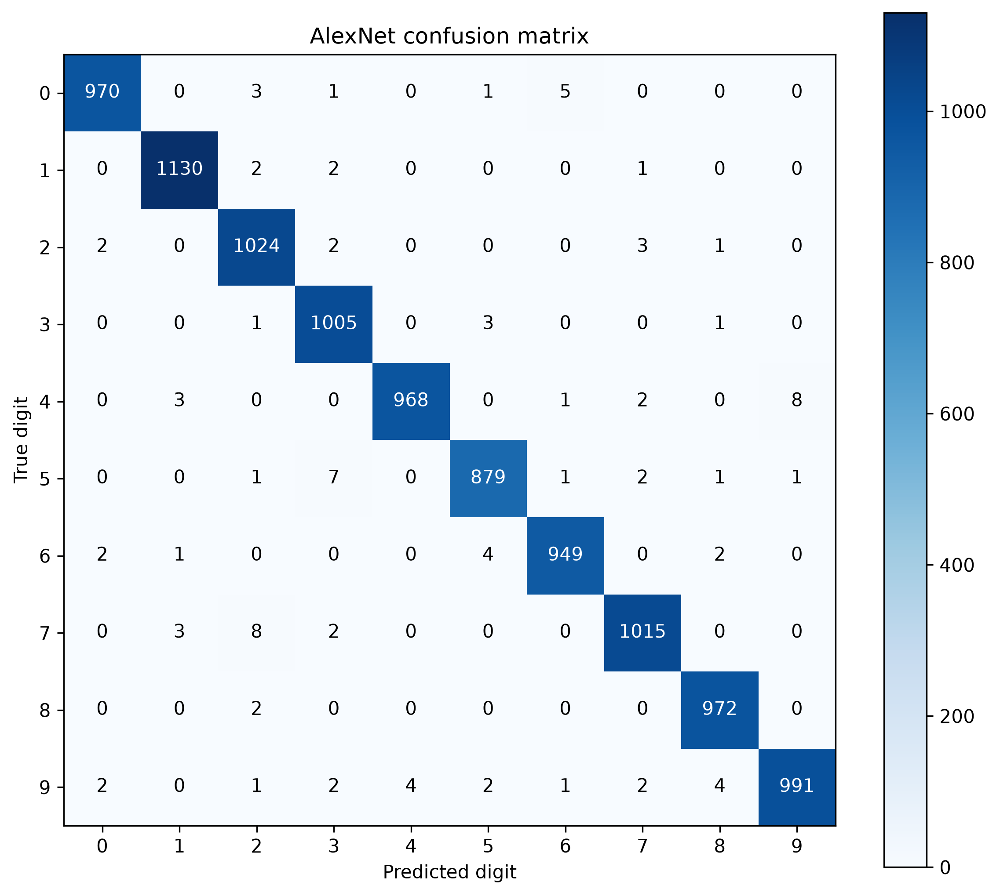
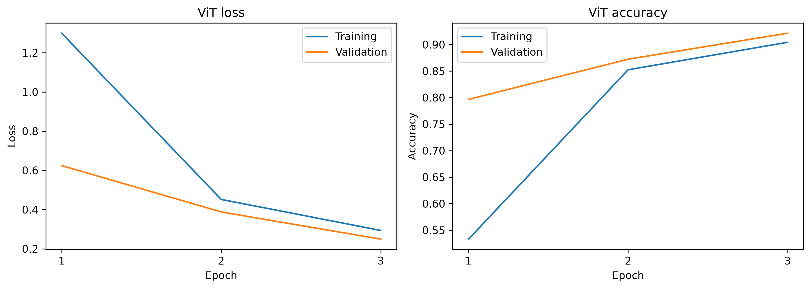
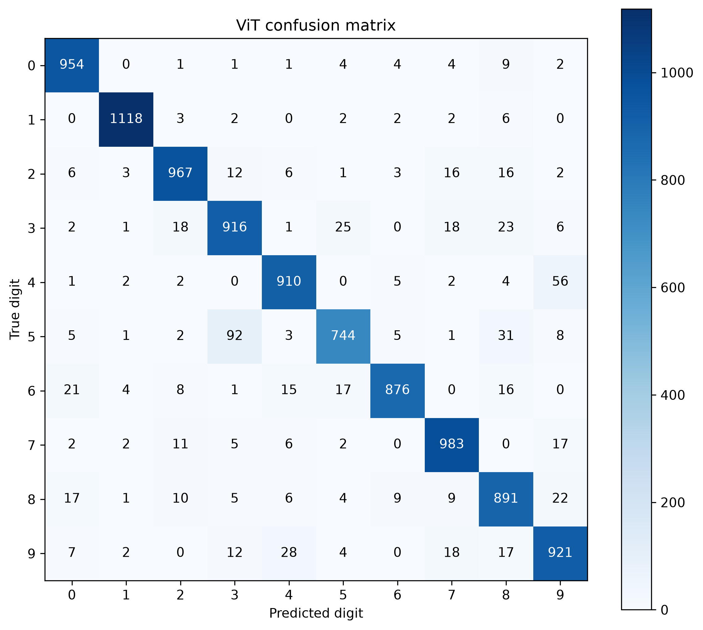

# Lab 2 - Image Classification with PyTorch

We compared five neural networks on MNIST: a CNN, Faster R-CNN, VGG16, AlexNet and a Vision Transformer built from scratch.

## Dataset and evaluation

MNIST contains grayscale images of handwritten digits from 0 to 9. We used 55,000 images for training, 5,000 for validation and the official 10,000-image test set. We recreated the same training and validation split with seed 42 for all five models.

We used validation results to select the saved model, then evaluated it on the test set. Accuracy measures the proportion of correctly classified images. Macro F1 gives equal importance to each digit, while weighted F1 accounts for how often each digit appears. In the confusion matrices, rows represent the true digits and columns represent the predictions.

## Part 1 - CNN and transfer learning

### 1. CNN classifier

We kept the images at 28 × 28 pixels and normalized them with mean 0.1307 and standard deviation 0.3081. Our CNN used two convolution layers with 32 and 64 filters. Both had a 3 × 3 kernel, stride 1 and padding 1. ReLU introduced nonlinearity, and 2 × 2 max pooling reduced the image dimensions after each convolution.

We flattened the resulting features and passed them through fully connected layers with 128 and 10 outputs. We used dropout rates of 0.25 and 0.5, together with weight decay, to limit overfitting.

We trained for 10 epochs with Adam, a learning rate of 0.001, weight decay of 0.0001 and a batch size of 64. The model returned raw logits for cross-entropy loss. We saved the checkpoint with the lowest validation loss.

The CNN reached **99.29% test accuracy** with a test loss of **0.021814**. Training took **41.54 seconds**, excluding validation.

### 2. Faster R-CNN

Faster R-CNN detects objects and predicts their classes. Since MNIST provides digit labels without bounding boxes, we created a box around the pixels with intensity greater than 0.1. We repeated each grayscale image across three channels and shifted labels to 1-10, leaving label 0 for background.

We built the model from scratch with a small CNN backbone containing two convolution layers with 32 and 64 channels. We used anchor sizes of 8, 16 and 24 pixels, aspect ratios of 0.5, 1 and 2, and RoIAlign with a 7 × 7 output. We kept the images at 28 × 28 pixels.

We trained for 10 epochs with Adam, a learning rate of 0.001 and a batch size of 4. We selected the checkpoint with the highest validation accuracy: **98.92% at epoch 9**. To compare classification results, we used the highest-scoring detection as the predicted digit. We counted an image with no detection as an error.

The model reached **98.90% test accuracy** and took **2644.91 seconds** to train. Its final epoch's training loss was **0.0287**. This loss includes classification and box regression terms; it is not a test cross-entropy loss.

### 3. CNN and Faster R-CNN comparison

The CNN achieved higher accuracy and F1 scores while training about **64 times faster**. Faster R-CNN also learned to locate the digit, which added work beyond classification. For images containing one digit, our CNN was the more efficient solution.

We did not compare their loss values directly. The CNN used classification cross-entropy, while Faster R-CNN optimized several detection losses. We also recorded the CNN's test loss and Faster R-CNN's training loss, so they represent different measurements.

### 4. Fine-tuning VGG16 and AlexNet

We started from ImageNet-pretrained weights. We resized MNIST images directly to 224 × 224 pixels, repeated the grayscale channel to obtain three channels, and applied ImageNet normalization. We kept the same data split.

For VGG16, we fine-tuned the last convolution block. For AlexNet, we fine-tuned the last convolution layer. In both models, we replaced the final classifier layer with 10 outputs and froze the remaining parameters. This allowed us to adapt part of each pretrained model to handwritten digits.

We trained both for three epochs with Adam, a learning rate of 0.0001, weight decay of 0.0001 and a batch size of 16. Both saved checkpoints came from epoch 2, which had the lowest validation loss.

VGG16 reached **99.43% test accuracy**, with a test loss of **0.017559** and a training time of **880.25 seconds**.

AlexNet reached **99.03% test accuracy**, with a test loss of **0.025695** and a training time of **212.16 seconds**.

VGG16 gave the highest accuracy in this part. Its gain over the CNN was **0.14 percentage points**, while training took about **21 times longer**. The CNN gave us the best balance between accuracy and training time.

## Part 2 - Vision Transformer from scratch

### 1. Architecture and training

We followed [Brian Pulfer's tutorial](https://www.brianpulfer.ch/blog/vit) to build a small Vision Transformer. We reused the original normalized 28 × 28 grayscale images and the same data split.

We divided each image into a 7 × 7 grid, giving **49 patches of 4 × 4 pixels**. Each patch became a vector of 16 pixel values, which a linear layer mapped to a 32-dimensional embedding. We added a learnable classification token and sinusoidal positional encodings so the model could distinguish patch positions.

We implemented multi-head self-attention manually with query, key and value projections, scaled dot products and softmax attention weights. Two encoder blocks combined attention, layer normalization, residual connections and an MLP with GELU activation. Each block used two attention heads. The final linear layer classified the output of the classification token into 10 digits.

We used batch tensor operations instead of loops over individual images. Our embedding dimension was 32 rather than the tutorial's 8. We also returned raw logits instead of applying a final softmax, since we used cross-entropy loss.

We trained from scratch for **three epochs**, using Adam with a learning rate of **0.001** and a batch size of **128**. We selected the checkpoint with the lowest validation loss.

### 2. Results and comparison

The ViT reached **92.80% test accuracy**, a macro F1 of **0.926598** and a test loss of **0.225594**. Training took **12.10 seconds**, excluding validation. It trained fastest in our experiments, but obtained the lowest test accuracy.

| Model | Test accuracy | Macro F1 | Weighted F1 | Training time (s) | Epochs |
| --- | ---: | ---: | ---: | ---: | ---: |
| CNN | 99.29% | 0.992847 | 0.992896 | 41.54 | 10 |
| Faster R-CNN | 98.90% | 0.988977 | 0.988982 | 2644.91 | 10 |
| VGG16 | 99.43% | 0.994246 | 0.994300 | 880.25 | 3 |
| AlexNet | 99.03% | 0.990239 | 0.990298 | 212.16 | 3 |
| ViT | 92.80% | 0.926598 | 0.927912 | 12.10 | 3 |

The ViT scored **6.49 percentage points below the CNN**. Our small architecture and short training run show that we can build and train a transformer, but do not establish that it reached its best possible performance. We would need to examine validation progress before deciding whether to train longer.

Training times include the training passes and exclude validation. We used different epoch counts, batch sizes and image sizes. VGG16 and AlexNet also benefited from pretrained weights. These results compare our completed runs, rather than models trained under identical conditions.

## What we learned

We learned how to build a CNN, adapt classification data for object detection, fine-tune pretrained networks and implement a small ViT. We also used validation results to select checkpoints and kept the test set for evaluation.

VGG16 gave us the highest accuracy, while the CNN achieved a similar result with much less training time. The ViT was quick to train, but its lower accuracy showed that speed alone was not enough to choose a model. For this MNIST experiment, the CNN remained the best practical balance.
